

<h2>About me</h2>
<h2>Vihaan Jain</h2>
<h3>🎓 B.Tech in Information Technology · VJTI Mumbai</h3>

<b>2nd Year</b> &nbsp;·&nbsp; <b>Minor:</b> Cybersecurity

<blockquote><b>I build things that catch my curiosity and solve problems.</b> I like getting under the hood, following an interesting question, and turning what I learn into something useful.</blockquote>
<table>
<tr>
<td valign="top" width="33%">
<h3>🧠 HOW I THINK</h3>

Curiosity first. I enjoy understanding how things work, not just making them work.

</td>
<td valign="top" width="33%">
<h3>🔭 EXPLORING</h3>

AI/ML, systems, cybersecurity, networks and communication.

</td>
<td valign="top" width="33%">
<h3>🎮 OFF-SCRIPT</h3>

DSA, competitive programming and exploring the world.

</td>
</tr>
</table>
<h2>On the workbench</h2>
<table>
<tr>
<td valign="top" width="50%">
<h3>MemoraDB</h3>

A temporal + semantic DBMS from scratch in C++, with time-travel queries and semantic search.

</td>
<td valign="top" width="50%">
<h3>DAWN</h3>

A networking project in progress. More details when it is ready.

</td>
</tr>
</table>
<h3>💬 Always up for a conversation about</h3>

<code>Systems</code> &nbsp; <code>Low-level</code> &nbsp; <code>AI / ML</code> &nbsp; <code>Networking</code> &nbsp; <code>DSA / CP</code> &nbsp; <code>Travel</code>


 

<h3>THE PROJECT FILES</h3>

Three completed builds and DAWN on the way — from storage engines to machine health and student tools.

<table width="100%">
<tr>
<td valign="top" width="50%">
<h3>🗄️ <a href="https://github.com/v1haan24/MemoraDB">MemoraDB</a></h3>

<b>Temporal DBMS</b> · C++ / Semantic Search

MemoraDB is a C++17 temporal and semantic DBMS built from scratch. It stores changes as immutable, append-only binary versions instead of overwriting records. It supports time-travel queries, snapshots, rollback, temporal indexing and diffs. Semantic columns can be embedded locally with ONNX Runtime and the all-MiniLM-L6-v2 model. A SQL-like query engine brings historical queries and semantic search together.

   

<a href="https://github.com/v1haan24/MemoraDB">Repository ↗</a>

</td>
<td valign="top" width="50%">
<h3>📈 <a href="https://github.com/v1haan24/Predictive-Maintenance-System">Predictive Maint.</a></h3>

<b>Engine Health</b> · LSTM / NASA CMAPSS

A deep-learning predictive-maintenance pipeline built around the NASA CMAPSS FD001 engine dataset. It preprocesses multivariate sensor readings and converts them into fixed-length time-series sequences. An LSTM model estimates Remaining Useful Life (RUL), rather than simply classifying an engine as failed or healthy. The training pipeline uses early stopping and evaluates predictions with RMSE. It also saves the trained model, produces training-loss visualisations and generates rule-based maintenance recommendations.

     

<a href="https://github.com/v1haan24/Predictive-Maintenance-System">Repository ↗</a>

</td>
</tr>
<tr>
<td valign="top" width="50%">
<h3>📅 <a href="https://github.com/v1haan24/Attendance-Tracker">Attendance</a></h3>

<b>Student Tool</b> · HTML / CSS / JavaScript

A lightweight attendance manager designed around the everyday student workflow. It lets students mark and edit daily attendance, organise a weekly timetable and inspect subject-wise and overall statistics. A bunk calculator helps estimate how many classes can be missed while staying above a target attendance percentage. Low-attendance alerts make it easier to spot subjects that need attention. The app runs entirely in the browser using LocalStorage, with no backend or database.

   

<a href="https://github.com/v1haan24/Attendance-Tracker">Repository ↗</a> &nbsp;·&nbsp; <a href="https://v1haan24.github.io/Attendance-Tracker/">Live demo ↗</a>

</td>
<td valign="top" width="50%">
<h3>🌅 Dawn (in development)</h3>

<b>Networking Project</b> · In Development

A networking project currently in development. Keeping the details under wraps until it is ready.

 

Details coming when it is ready

</td>
</tr>
</table>

<table>
  <tr>
    <td align="center" valign="top" width="33%"><a href="https://github.com/v1haan24/MemoraDB">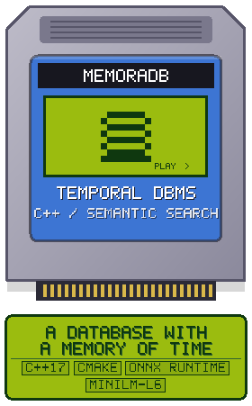</a>

More info

MemoraDB is a C++17 temporal and semantic DBMS built from scratch. It stores changes as immutable, append-only binary versions instead of overwriting records. It supports time-travel queries, snapshots, rollback, temporal indexing and diffs. Semantic columns can be embedded locally with ONNX Runtime and the all-MiniLM-L6-v2 model. A SQL-like query engine brings historical queries and semantic search together.

<a href="https://github.com/v1haan24/MemoraDB">Repository ↗</a>
</td>
    <td align="center" valign="top" width="33%"><a href="https://github.com/v1haan24/Predictive-Maintenance-System">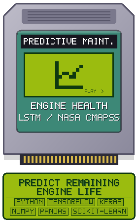</a>

More info

A deep-learning predictive-maintenance pipeline built around the NASA CMAPSS FD001 engine dataset. It preprocesses multivariate sensor readings and converts them into fixed-length time-series sequences. An LSTM model estimates Remaining Useful Life (RUL), rather than simply classifying an engine as failed or healthy. The training pipeline uses early stopping and evaluates predictions with RMSE. It also saves the trained model, produces training-loss visualisations and generates rule-based maintenance recommendations.

<a href="https://github.com/v1haan24/Predictive-Maintenance-System">Repository ↗</a>
</td>
    <td align="center" valign="top" width="33%"><a href="https://github.com/v1haan24/Attendance-Tracker">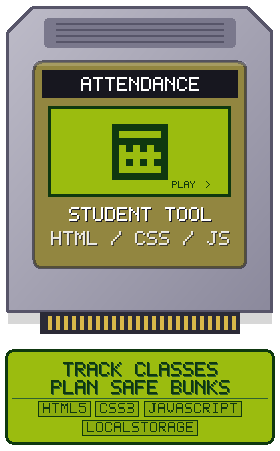</a>

More info

A lightweight attendance manager designed around the everyday student workflow. It lets students mark and edit daily attendance, organise a weekly timetable and inspect subject-wise and overall statistics. A bunk calculator helps estimate how many classes can be missed while staying above a target attendance percentage. Low-attendance alerts make it easier to spot subjects that need attention. The app runs entirely in the browser using LocalStorage, with no backend or database.

<a href="https://github.com/v1haan24/Attendance-Tracker">Repository ↗</a> &nbsp;·&nbsp; <a href="https://v1haan24.github.io/Attendance-Tracker/">Live demo ↗</a>
</td>
  </tr>
  <tr>
    <td align="center" valign="top" width="33%">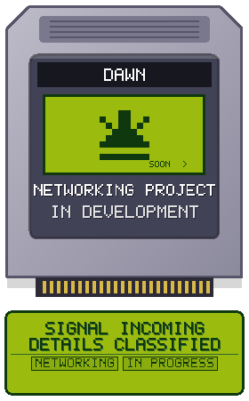

More info

A networking project currently in development. Keeping the details under wraps until it is ready.

<em>In development</em>
</td>
    <td align="center" valign="top" width="33%">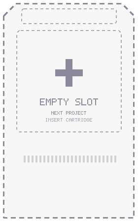

Future project

Project details will appear here when this slot is filled.

<em>Reserved for a future project</em>
</td>
    <td align="center" valign="top" width="33%">

Future project

Project details will appear here when this slot is filled.

<em>Reserved for a future project</em>
</td>
  </tr>
</table>

 

<h3>EQUIPMENT CHECK</h3>

A practical loadout, not a skill-level scoreboard. These are the languages, frameworks and tools I use or am learning.

<table width="100%">
<tr><td valign="top" width="26%"><b>Languages</b></td><td>     </td></tr>
<tr><td valign="top" width="26%"><b>Frontend</b></td><td>    </td></tr>
<tr><td valign="top" width="26%"><b>Backend &amp; Databases</b></td><td> </td></tr>
<tr><td valign="top" width="26%"><b>Tools &amp; Platforms</b></td><td>    </td></tr>
<tr><td valign="top" width="26%"><b>AI/ML &amp; Data</b></td><td>      </td></tr>
</table>


 

<h3>ACTIVITY ARCHIVE</h3>

<h2>THE PLAYER RECORD</h2>
Progress, one commit at a time.

<table>
<tr align="center"><td><h3>248</h3>contributions · last year</td><td><h3>53</h3>active days</td><td><h3>18</h3>best day</td><td><h3>5</h3>current streak</td><td><h3>6</h3>longest streak</td></tr>
</table>

<i>Every square is a small step forward. Keep showing up.</i>


 

<h3>CHOOSE YOUR CHANNEL</h3>

Different ways to reach me — pick whichever works best.

<table width="100%">
<tr><td align="center" valign="top" width="20%"><h3>🐙 GitHub</h3>
Projects, experiments and source code

<a href="https://github.com/v1haan24">v1haan24</a>
</td> <td align="center" valign="top" width="20%"><h3>✉️ Email</h3>
For a proper conversation

<a href="mailto:vihaanjain2411@gmail.com">vihaanjain2411@gmail.com</a>
</td> <td align="center" valign="top" width="20%"><h3>💼 LinkedIn</h3>
Professional updates and connections

<a href="https://www.linkedin.com/in/vihaanjain24/">Connect on LinkedIn</a>
</td> <td align="center" valign="top" width="20%"><h3>🎮 Discord</h3>
Find me on Discord

<a href="https://discord.com/users/899297371484217365">Open Discord profile</a>
</td> <td align="center" valign="top" width="20%"><h3>🌐 Portfolio</h3>
Personal site

<a href="https://google.com">Open portfolio</a>
</td></tr>
</table>

<table width="100%">
<tr><td align="center" valign="middle" width="20%"><a href="https://github.com/v1haan24">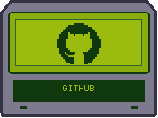</a></td> <td align="center" valign="middle" width="20%"><a href="mailto:vihaanjain2411@gmail.com">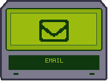</a></td> <td align="center" valign="middle" width="20%"><a href="https://www.linkedin.com/in/vihaanjain24/">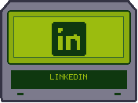</a></td> <td align="center" valign="middle" width="20%"><a href="https://discord.com/users/899297371484217365">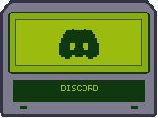</a></td> <td align="center" valign="middle" width="20%"><a href="https://google.com">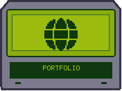</a></td></tr>
</table>

 

